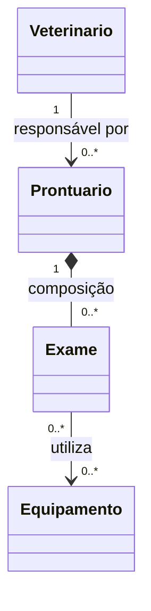

# 🐾 Veterinary Clinic Management System (Python OOP)


Projeto acadêmico **avaliativo** desenvolvido em **Python** para a disciplina de **Paradigmas de Programação / Orientação a Objetos**, focado na modelagem e implementação de um **Sistema de Gerenciamento de Clínica Veterinária**.

---

## 📑 Sumário

- [Contexto Acadêmico](#-contexto-acadêmico)
- [Sobre o Projeto](#-sobre-o-projeto)
- [Funcionalidades](#-funcionalidades)
- [Modelagem e Relacionamentos](#️-modelagem-e-relacionamentos-poo)
- [Diagrama de Classes](#-diagrama-de-classes)
- [Pilares da POO Aplicados](#-pilares-da-poo-aplicados)
- [Arquitetura em Camadas](#️-arquitetura-em-camadas)
- [Estrutura do Repositório](#-estrutura-do-repositório)
- [Como Executar](#-como-executar)
- [Exemplo de Uso](#-exemplo-de-uso)
- [Tecnologias](#️-tecnologias)
- [Melhorias Futuras](#-melhorias-futuras)
- [Autor](#-autor)

---

## 🎓 Contexto Acadêmico

Este projeto foi desenvolvido como **trabalho avaliativo** da disciplina de Paradigmas de Programação / Orientação a Objetos.

- **Tipo de entrega:** atividade prática avaliativa
- **Disciplina:** Paradigmas de Programação / Orientação a Objetos
- **Critérios avaliados:**
  - Modelagem UML (diagrama de classes)
  - Aplicação correta dos pilares da POO
  - Implementação dos relacionamentos (composição e associação)
  - Organização e separação do código em camadas
  - Funcionamento do sistema via CLI
  - Documentação técnica (`MODELAGEM.pdf`)
- **Finalidade:** fins estritamente educacionais, sem uso comercial

---

## 🎯 Sobre o Projeto

O sistema simula o fluxo operacional de uma clínica veterinária, permitindo o gerenciamento de profissionais, registros clínicos, exames e recursos físicos.

**Objetivos:**

- Aplicar na prática os conceitos de POO
- Demonstrar relacionamentos entre classes (composição e associação)
- Separar domínio, persistência e interface em módulos distintos
- Documentar a solução com diagrama UML e relatório técnico

---

## ✨ Funcionalidades

<!-- AJUSTAR: confira se todas existem no seu menu -->

- 👨‍⚕️ Cadastro e consulta de **veterinários**
- 📋 Criação e gerenciamento de **prontuários**
- 🧪 Registro de **exames** vinculados a um prontuário
- 🩺 Controle de **equipamentos** usados nos procedimentos
- 🔎 Listagem e busca de registros
- 🗑️ Remoção de prontuários (com remoção em cascata dos exames)
- 🖥️ Menu interativo via terminal (CLI) e cenários de teste

---

## 🏛️ Modelagem e Relacionamentos (POO)

O projeto implementa relações estruturais fundamentais da POO:

- **Composição (`Prontuario` ◆— `Exame`)**
  - O prontuário gerencia o ciclo de vida dos exames vinculados a ele
  - Se o prontuário for removido, seus exames deixam de existir no escopo
- **Associação (`Veterinario` — `Prontuario`)**
  - O veterinário é o responsável pelo prontuário
  - Os objetos têm ciclo de vida independente
- **Associação (`Exame` — `Equipamento`)**
  - Os equipamentos são utilizados nos procedimentos de exame
  - Os objetos têm ciclo de vida independente

---

## 📐 Diagrama de Classes

O diagrama UML completo e o relatório de justificativa técnica estão em [`MODELAGEM.pdf`](./MODELAGEM.pdf). Visão resumida:



<!-- AJUSTAR: adicione atributos e métodos reais das suas classes -->

---

## 🧱 Pilares da POO Aplicados

- **Abstração:** as classes representam apenas dados e comportamentos relevantes para a clínica
- **Encapsulamento:** atributos protegidos/privados com acesso controlado por métodos e `@property`
- **Herança:** <!-- AJUSTAR: descreva classes base/derivadas, se houver -->
- **Polimorfismo:** <!-- AJUSTAR: descreva métodos sobrescritos, ex.: `__str__` -->

---

## 🗂️ Arquitetura em Camadas

```
┌──────────────────────────┐
│   main.py  (Interface)   │  Menu CLI e cenários de teste
├──────────────────────────┤
│  repository.py (Dados)   │  Persistência em memória
├──────────────────────────┤
│   models.py   (Domínio)  │  Entidades e regras de negócio
└──────────────────────────┘
```

- **Domínio (`models.py`):** entidades, encapsulamento e relacionamentos
- **Persistência (`repository.py`):** gerencia as coleções de objetos em memória
- **Apresentação (`main.py`):** interação com o usuário e orquestração do fluxo

---

## 📂 Estrutura do Repositório

```
veterinary-clinic-management-system/
├── MODELAGEM.pdf
├── README.md
└── codigos/
    ├── models.py
    ├── repository.py
    └── main.py
```

- `MODELAGEM.pdf` — Diagrama de Classes UML completo e relatório de justificativa técnica
- `codigos/` — Implementação modular do sistema
  - `models.py` — Entidades de domínio (classes, atributos, encapsulamento e relacionamentos)
  - `repository.py` — Camada de gerenciamento e persistência de dados em memória
  - `main.py` — Ponto de entrada com menu interativo via CLI e cenários de teste

---

## 🚀 Como Executar

**Pré-requisitos:**

- Python 3.10+ ([download](https://www.python.org/downloads/))
- Git (opcional, para clonar o repositório)

**Passo a passo:**

1. Verifique a versão do Python:

   ```bash
   python --version
   ```

2. Clone o repositório (ou baixe o ZIP pelo GitHub):

   ```bash
   git clone https://github.com/FelipeBritoSP10/veterinary-clinic-management-system.git
   cd veterinary-clinic-management-system
   ```

3. Acesse a pasta do código:

   ```bash
   cd codigos
   ```

4. Execute o sistema:

   ```bash
   python main.py
   ```

> Em Linux/macOS, se `python` apontar para o Python 2, use `python3 main.py`.
> O projeto usa apenas a biblioteca padrão, então **não há dependências externas**.

---

## 💻 Exemplo de Uso

<!-- AJUSTAR: substitua pelo menu real do seu main.py -->

```
===== CLÍNICA VETERINÁRIA =====
1 - Cadastrar veterinário
2 - Criar prontuário
3 - Adicionar exame ao prontuário
4 - Listar prontuários
5 - Remover prontuário
0 - Sair
Escolha uma opção:
```

---

## 🛠️ Tecnologias

- Python 3.10+
- Programação Orientada a Objetos
- UML (diagrama de classes)
- CLI (interface de linha de comando)

---

## 🔮 Melhorias Futuras

- [ ] Persistência em arquivo (JSON/CSV) ou banco de dados (SQLite)
- [ ] Cadastro de **Tutores** e **Pacientes (animais)**
- [ ] Agendamento de consultas
- [ ] Testes automatizados com `unittest` ou `pytest`
- [ ] Interface gráfica ou API REST
- [ ] Validação de dados mais robusta

---

## 👤 Autor

**Felipe Brito**

- GitHub: [@FelipeBritoSP10](https://github.com/FelipeBritoSP10)
- Projeto desenvolvido para fins **acadêmicos e avaliativos**
